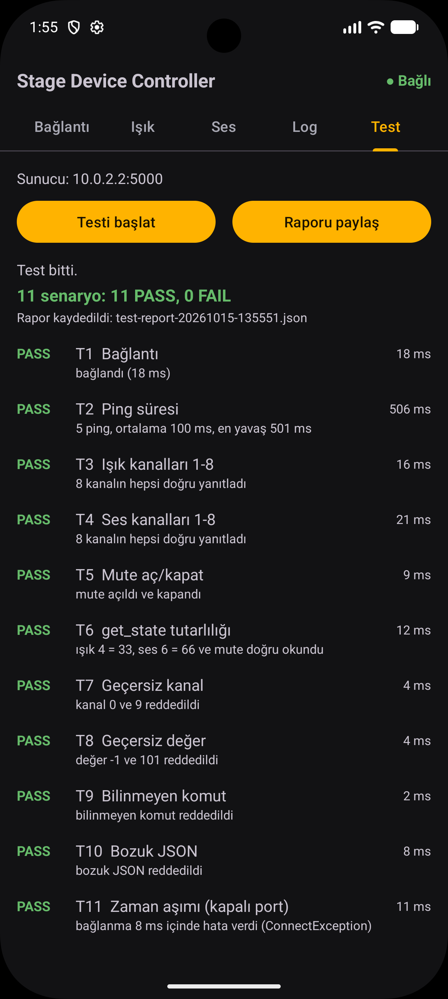
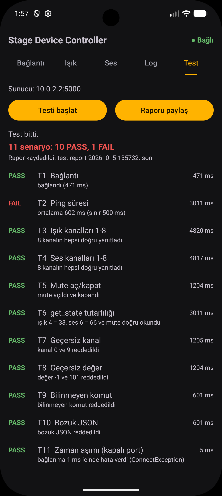
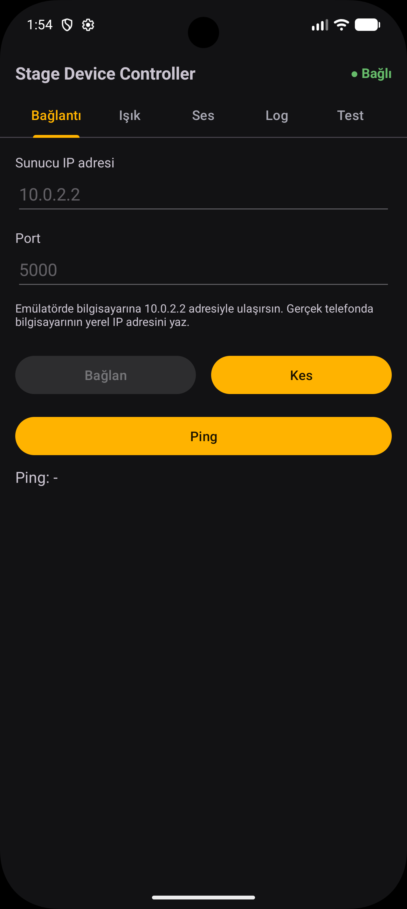
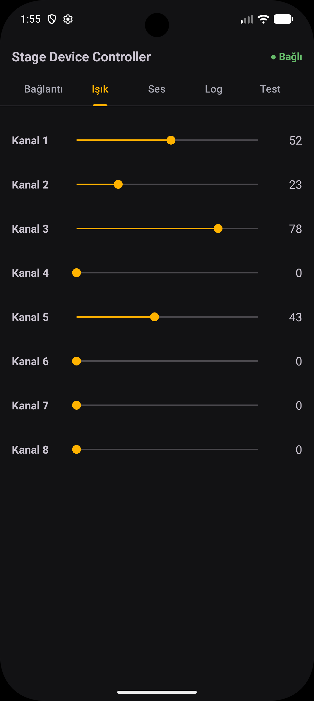
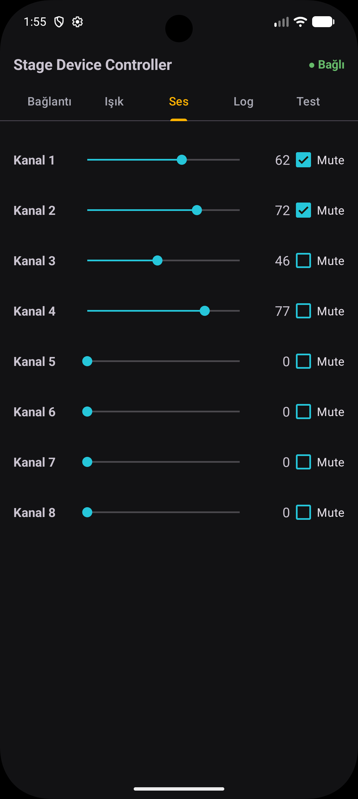
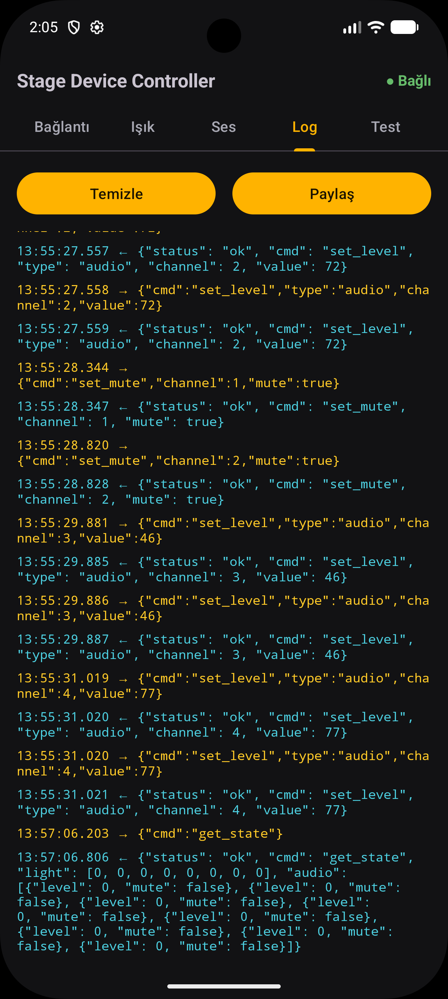
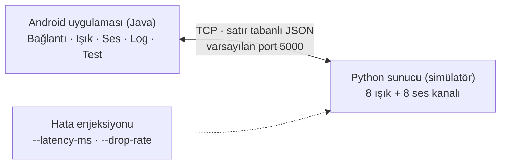

# Stage Device Controller

[](https://github.com/gizemclskn/stage-device-controller/actions/workflows/python-tests.yml)


**TR:** Ağ üzerindeki bir sahne ışık/ses cihazını TCP üzerinden kontrol eden Android (Java) uygulaması. Gerçek donanım yerine Python ile yazılmış bir simülatör sunucu kullanılır. Uygulamanın içinde, cihazı otomatik sınayıp PASS/FAIL raporu üreten bir **Test Modu** vardır.

**EN:** Android (Java) app that controls a stage lighting/audio device over TCP. A Python simulator server stands in for the real hardware. The app includes a built-in **Test Mode** that runs a scenario suite against the device and produces a PASS/FAIL report.

<!-- DEMO GIF: çekilince aşağıdaki satırın başındaki ve sonundaki yorum işaretlerini kaldır

-->

[Hızlı başlangıç](#hızlı-başlangıç) · [Protokol](docs/protocol.md) · [Ağ notları](docs/network-notes.md)

---

## Test Modu iki yüzlü çalışır

Aynı test takımı sağlam sunucuda PASS, hata enjekte edilmiş sunucuda FAIL verir. Yani test, gerçekten hata yakaladığını kanıtlar.

| Sağlam sunucu: PASS | Hata enjeksiyonlu sunucu: FAIL |
|---|---|
|  |  |

## Ekranlar

| Bağlantı | Işık | Ses | Log |
|---|---|---|---|
|  |  |  |  |

## Mimari



- **Sunucu** (`server/`): yalnızca Python standart kütüphanesi. Her istemci için ayrı thread, ortak durum `threading.Lock` ile korunur.
- **Uygulama** (`android-app/`): Java, minSdk 24. Ağ işi arka planda tek thread'li bir `ExecutorService` üzerinde çalışır. `SocketClient` `Application` düzeyinde yaşar, bu yüzden ekran döndürünce bağlantı kopmaz.
- **Protokol**: TCP üzerinden satır başına bir JSON nesnesi (newline-delimited JSON). Ayrıntı: [docs/protocol.md](docs/protocol.md).

## Hızlı başlangıç

Gereksinimler: Python 3.12, Android Studio (emülatör veya gerçek telefon).

**1. Sunucuyu başlat**

```
python server\server.py
```

Linux/macOS'ta `python3 server/server.py`. Sunucu varsayılan olarak `0.0.0.0:5000` üzerinde dinler.

| Seçenek | Anlamı | Varsayılan |
|---|---|---|
| `--host HOST` | Dinlenecek adres | `0.0.0.0` |
| `--port PORT` | Dinlenecek port (1-65535) | `5000` |
| `--idle-timeout SANİYE` | Bu kadar süre sessiz kalan istemci kapatılır | `300` |
| `--latency-ms MS` | Hata enjeksiyonu: her yanıtı geciktirir | `0` |
| `--drop-rate ORAN` | Hata enjeksiyonu: yanıtların bu oranda (0-1) hiç gönderilmemesi | `0` |

**2. Sunucuyu elle dene (isteğe bağlı)**

Başka bir pencerede:

```
python server\test_client.py
```

**3. Uygulamayı çalıştır**

1. Android Studio'da `android-app/` klasörünü aç.
2. Emülatörde veya telefonda çalıştır.
3. **Bağlantı** sekmesinde sunucu adresini yaz ve **Bağlan**'a bas:
   - Emülatör: `10.0.2.2`, port `5000`
   - Gerçek telefon: bilgisayarın yerel IP adresi (`ipconfig` ile bul), aynı Wi-Fi ağında olun
4. **Işık** ve **Ses** sekmelerinden kaydırıcıları oynat, sunucu konsolunda komutları izle.

**4. Python testlerini çalıştır**

```
cd server
python -m unittest -v
```

Aynı testler her push'ta GitHub Actions'ta (Python 3.12) çalışır.

## Özellikler

- **Işık ve ses kontrolü:** 8 ışık, 8 ses kanalı, ses kanallarında mute. Kaydırıcı parmak kalkınca komut gönderir, sürüklerken en fazla her 100 ms'de bir.
- **Bağlanınca durum yüklenir:** `get_state` ile arayüz sunucudaki gerçek değerlere getirilir.
- **Log ekranı:** gönderilen ve alınan her mesaj zaman damgasıyla listelenir (en fazla 500 kayıt). Temizlenebilir, metin olarak paylaşılabilir. Destek senaryosunda "ne gönderdik, ne geldi" sorusunu yanıtlar.
- **Dayanıklılık:** bağlantı koparsa otomatik yeniden bağlanma (en fazla 5 deneme, 1-2-4-8-16 sn bekleme). Geçersiz ya da beklenmeyen yanıt uygulamayı çökertmez, loglanır.
- **Test Modu:** 11 senaryoyu otomatik çalıştırır, sonucu JSON rapor olarak kaydeder ve paylaşır.
- **Hata enjeksiyonu:** sunucuya yapay gecikme ve yanıt düşürme eklenir.

## Protokol özeti

Satır başına bir JSON nesnesi, UTF-8, varsayılan port 5000. Kanallar 1-8, değerler 0-100 arası tam sayı.

| Komut | İstek | Başarılı yanıt |
|---|---|---|
| ping | `{"cmd":"ping"}` | `{"status":"ok","cmd":"pong"}` |
| set_level | `{"cmd":"set_level","type":"light","channel":3,"value":75}` | aynı alanlar + `"status":"ok"` |
| set_mute | `{"cmd":"set_mute","channel":2,"mute":true}` | `{"status":"ok","cmd":"set_mute","channel":2,"mute":true}` |
| get_state | `{"cmd":"get_state"}` | `{"status":"ok","cmd":"get_state","light":[...],"audio":[...]}` |

Hatalarda `{"status":"error","code":"...","message":"..."}` döner. İstemci yalnızca `code` alanına bakar: `INVALID_JSON`, `UNKNOWN_CMD`, `INVALID_CHANNEL`, `INVALID_VALUE`. Tam kurallar, hata tablosu ve zaman aşımı davranışı: [docs/protocol.md](docs/protocol.md).

## Test Modu

Uygulamanın **Test** sekmesinde **Testi başlat**'a basınca, **Bağlantı** sekmesinde en son bağlanılan adrese karşı aşağıdaki senaryolar sırayla çalışır:

| ID | Senaryo | PASS koşulu |
|---|---|---|
| T1 | Bağlantı | Süre içinde bağlandı |
| T2 | Ping süresi | 5 ping, ortalama < 500 ms |
| T3 | Işık kanalları 1-8 | Her yanıt gönderilenle eşleşiyor |
| T4 | Ses kanalları 1-8 | Aynı |
| T5 | Mute aç/kapat | Yanıtlar doğru |
| T6 | `get_state` tutarlılığı | Durum son yazılanlarla uyumlu |
| T7 | Geçersiz kanal | `INVALID_CHANNEL` döner |
| T8 | Geçersiz değer | `INVALID_VALUE` döner |
| T9 | Bilinmeyen komut | `UNKNOWN_CMD` döner |
| T10 | Bozuk JSON | `INVALID_JSON` döner |
| T11 | Zaman aşımı | Kapalı porta bağlanma süre içinde hata veriyor, arayüz donmuyor |

Sonuç ekranda yeşil/kırmızı listelenir, bir özet satırı gösterilir. Rapor uygulamanın kendi klasörüne zaman damgalı JSON dosyası olarak kaydedilir ve **Raporu paylaş** ile gönderilebilir.

### Hata enjeksiyonu ile deneme

Sağlam sunucuda tüm senaryolar PASS olmalıdır. Sonra sunucuyu bozup aynı testi tekrar çalıştır:

```
python server\server.py --latency-ms 600
python server\server.py --drop-rate 0.5
```

- `--latency-ms 600`: her yanıt 600 ms gecikir, T2'nin ortalama süre sınırı (500 ms) aşılır ve T2 FAIL olur.
- `--drop-rate 0.5`: komutların yarısı yanıtsız kalır. Okuma zaman aşımına (3 sn) uğrayan senaryo FAIL olur.

## Sorun giderme

| Belirti | Olası neden | Çözüm |
|---|---|---|
| Hemen "bağlantı reddedildi" | Sunucu kapalı ya da port yanlış | Sunucuyu başlat, portu kontrol et |
| Bekliyor, sonra zaman aşımı | IP yanlış, farklı ağ ya da güvenlik duvarı | `ipconfig` ile IP'yi doğrula, aynı Wi-Fi'de ol, güvenlik duvarı kuralını ekle |
| `test_client.py` çalışıyor, emülatörden çalışmıyor | Uygulama `127.0.0.1` kullanıyor | Emülatörde `10.0.2.2` yaz. Emülatörün içinde `127.0.0.1` bilgisayarı değil emülatörün kendisini gösterir |
| Emülatörde çalışıyor, telefonda çalışmıyor | Güvenlik duvarı ya da farklı ağ | Aşağıya bak |
| Sunucu başlarken "adres kullanımda" | Başka bir sunucu örneği portu tutuyor | Onu kapat ya da `--port` ile başka port seç |

**Gerçek telefon için Windows güvenlik duvarı.** Python bir portu ilk kez dinlediğinde Windows izin ister, **Özel ağlar**'ı seç. Uyarıyı kaçırdıysan PowerShell'i **yönetici olarak** açıp kural ekle:

```
New-NetFirewallRule -DisplayName "stage-device-controller (TCP 5000)" -Direction Inbound -Protocol TCP -LocalPort 5000 -Action Allow -Profile Private
```

İşin bitince kuralı sil:

```
Remove-NetFirewallRule -DisplayName "stage-device-controller (TCP 5000)"
```

Misafir Wi-Fi ağları, açık VPN'ler ve bazı yönlendiricilerdeki "istemci yalıtımı" cihazlar arası trafiği engeller. Bilgisayarda hızlı kontrol: sunucu açıkken `Test-NetConnection 127.0.0.1 -Port 5000` sonucunda `TcpTestSucceeded : True` görmelisin. Ayrıntılar: [docs/network-notes.md](docs/network-notes.md).

## Sektör notu: DMX, Art-Net, OSC

Sahne ve AV dünyasında ışık için genellikle DMX512 (seri hat, kanal başına 0-255 değer) ve onu IP ağına taşıyan Art-Net, ses ve kontrol yüzeyleri için sıkça OSC (adres kalıplı mesajlar) kullanılır. Bu proje bu standartlarla uyumlu değildir ve olduğunu iddia etmez. Bilerek sade bir protokol seçildi: TCP güvenilir teslimat ve her komuta yanıt sağlar, JSON satırları gözle okunup elle yazılabilir, hata kodları test etmeyi ve destek vakalarında log okumayı kolaylaştırır. Amaç, ağdaki bir cihazı kontrol etme, sınama ve sorun giderme akışını uçtan uca göstermektir.

## Bilinen sınırlamalar ve gelecek çalışmalar

- Kimlik doğrulama ve TLS yok. Simülatörü yalnızca güvendiğin ağlarda kullan.
- Gerçek donanım yok, yalnızca simülatör. Tek cihaz kontrol edilir.
- Sunucu 300 sn boyunca sessiz kalan istemciyi kapatır. Uygulama bunu bir sonraki komutta fark edip yeniden bağlanır.
- Emülatörde sunucu kapanışı uygulamaya hemen ulaşmaz: durum bir süre "Bağlı" kalır, kopma ilk komutta algılanır.
- Android arayüz testleri (Espresso) yok. Android tarafında JUnit birim testleri var, ama CI yalnızca Python testlerini çalıştırır.
- Fikirler: ışık/ses durumunu isimle kaydeden preset sistemi, birden çok istemcinin durumunu birbirine bildirme, CI'a Android derleme adımı eklemek.

## Öğrendiklerim

**CI'da çöken, yerelde geçen test.** Python testlerini GitHub Actions'a bağladıktan sonra, yerelde geçen testler CI'da çöktü. Sorun test yardımcısı `FakeClient.close` içindeydi: bağlantıyı kapatıp hemen dönüyordu, oysa sunucu thread'i hâlâ çalışıyor olabilirdi. Test bittiğinde `log` fonksiyonunun mock'u kalkıyor, thread de gerçek `log()`'a yazmaya kalkıp kapanışta çöküyordu. Düzeltme (`75891e8`): `close` artık sunucu thread'inin çıkmasını bekliyor (`thread.join(timeout=3)`). Çıkarım: arka planda thread çalıştıran testlerde, thread'in test bitmeden önce temizlenmesi gerekir, yoksa hata zamanlamaya bağlı ve tekrarlanması zor olur.

**TCP bir akıştır.** Mesaj sınırı yoktur, bir satır iki parçada da gelebilir, iki satır birleşik de. Bu yüzden hem sunucuda hem istemcide satır tamponlama var. Aşırı uzun satırlar (1 KB üzeri) `INVALID_JSON` ile reddedilir, satırın kalanı atılır, bağlantı açık kalır.

**Geç gelen yanıt, bir sonraki komutun yanıtı sanılabilir.** Bu yüzden okuma zaman aşımında istek başarısız sayılıyor ve bağlantı `LOST` durumuna düşüp yeniden kuruluyor. Bu tasarım kararı protokol belgesinde de yazılı.

**Emülatör ile gerçek ağ farklı davranır.** Emülatörde `127.0.0.1` bilgisayarı göstermez, `10.0.2.2` gerekir. Emülatörde sunucu kapanışı da uygulamaya hemen yansımaz. Bu davranışı elle test ederken gözlemledim ve dayanıklılık testlerini buna göre kurdum.

## Proje yapısı

```
android-app/    Android uygulaması (Java, Gradle)
server/         Python simülatör sunucusu, elle test istemcisi, unittest testleri
docs/           Protokol, ağ notları, proje planı, ekran görüntüleri
.github/        CI workflow'u (python-tests.yml) ve hata raporu şablonu
```
